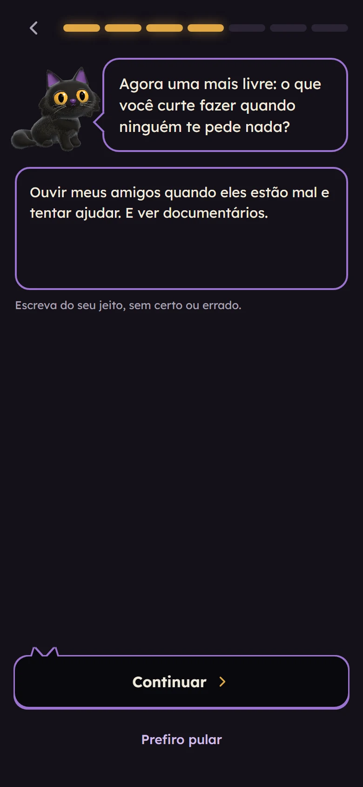
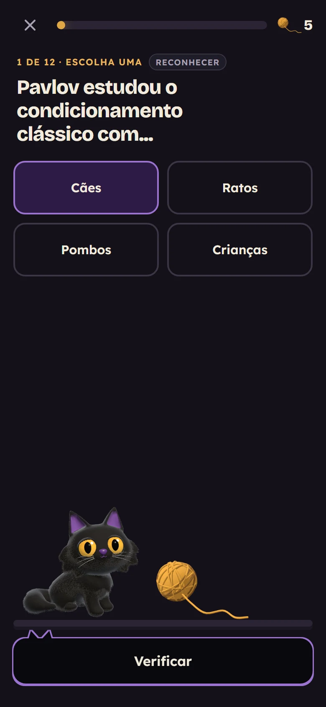

<p align="center">
  
</p>

<p align="center">
  <a href="https://aranduvocacional.com"></a>
  
  
</p>

<p align="center">
  <a href="https://aranduvocacional.com"></a>
</p>

O **Arandu** é um app de orientação vocacional com inteligência artificial para quem está escolhendo um curso superior no Brasil, em qualquer momento da vida. Quem acompanha é o próprio Arandu, um gato preto curioso e honesto. "Arandu" vem do guarani e quer dizer **sabedoria**.

## O problema

Escolher um curso é difícil, e errar custa caro. Em 2024, **24,8%** dos estudantes de cursos presenciais deixaram o curso, e **41,6%** no ensino a distância ([Semesp](https://www.semesp.org.br/mapa/edicao-16/brasil/)). De quem entrou em 2015, só **39%** se formou em dez anos ([INEP](https://download.inep.gov.br/publicacoes/institucionais/avaliacoes_e_exames_da_educacao_superior/resumo_tecnico_do_censo_da_educacao_superior_2024.pdf)).

Escolhe-se pelo nome da profissão, sem nunca ter experimentado o que se estuda.

## A solução

**Experimentar antes de escolher.**

<table>
  <tr>
    <td align="center" width="33%"></td>
    <td align="center" width="33%"></td>
    <td align="center" width="33%"></td>
  </tr>
  <tr>
    <td valign="top"><b>1 · Conhecer você.</b> O Arandu conversa com você, uma pergunta de cada vez.</td>
    <td valign="top"><b>2 · Opções reais.</b> Cursos que combinam com você, com as matérias reais do primeiro semestre.</td>
    <td valign="top"><b>3 · Experimentar.</b> Exercícios curtos de uma matéria de verdade.</td>
  </tr>
</table>

A decisão é sua: continuar, experimentar outro curso ou voltar a um que já testou. Cada dado tem fonte pública, e quando um dado não existe, ele não aparece.

**Feito com dados reais:** 540+ instituições e 7.800+ cursos de São Paulo ([INEP](https://download.inep.gov.br/microdados/microdados_censo_da_educacao_superior_2024.zip)), 66 mil+ matérias das grades de 24 instituições e 2 mil+ fontes públicas citadas.

## Estado

Em desenvolvimento para o **Hack Brasil 2026**, na trilha Acesso à educação.

- ✅ O site, [aranduvocacional.com](https://aranduvocacional.com): o quarto do Arandu em 3D, com os livros dos cursos.
- ✅ Os dados e a API que conversa com a pessoa.
- 🛠️ O app ainda está sendo construído.

## Para desenvolver

Monorepo Turborepo com workspaces do npm ([ADR 0003](docs/adr/0003-backend-architecture-and-monorepo.md)).

| Pasta | O que é |
|---|---|
| `apps/web` | O site em Next.js, na Vercel ([ADR 0001](docs/adr/0001-web-landing-stack-and-architecture.md)) |
| `apps/api` | A API em NestJS, a única porta para os dados, no Render |
| `apps/engine` | O motor de dados em Python, que mantém os dados públicos atualizados |
| `packages/contracts` | Os tipos das respostas da API ([ADR 0004](docs/adr/0004-profession-book-contract-and-ingestion-scope.md)) |
| `packages/db-types` | Os tipos derivados do esquema do banco |
| `supabase/` | Migrations e testes do banco |

```sh
npm install           # todos os workspaces
npm run dev           # o site e a API
npm run check         # build, typecheck, lint e testes; rode antes de cada merge (não há CI)
```

Copie `.env.example` para `.env` com os valores do projeto Supabase; o `.env` nunca é commitado.

| Parte | Produção (`main`) | Desenvolvimento (`dev`) |
|---|---|---|
| `apps/web` (Vercel) | [aranduvocacional.com](https://aranduvocacional.com) | prévias |
| `apps/api` (Render) | `arandu-api-prod` | `arandu-api` |
| Banco (Supabase) | `npx supabase db push` antes de mergear uma migration | |

## Quem fez

[Alejandro Luna](https://alejandrolunadev.site/es).

## Licença

[Apache 2.0](LICENSE).
