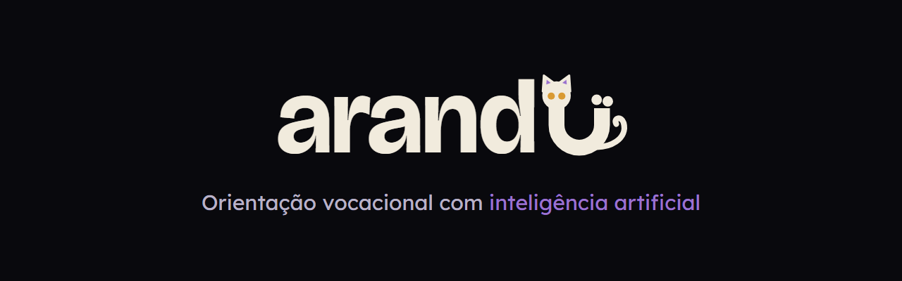
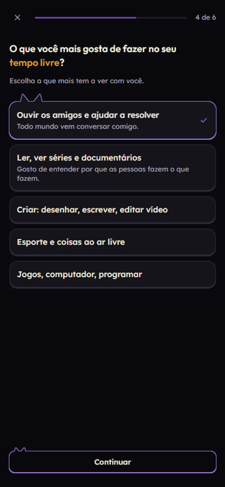
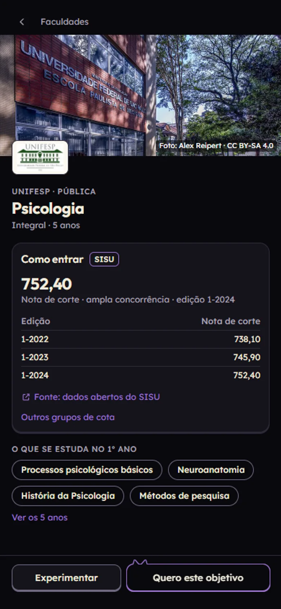
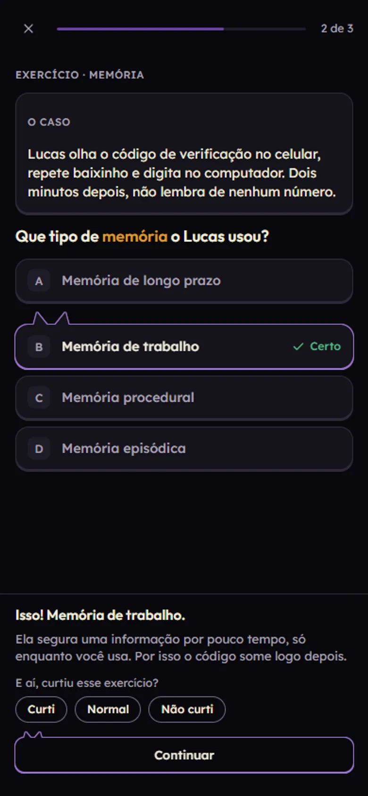

<p align="center">
  
</p>

<p align="center">
  <a href="https://aranduvocacional.com"></a>
  
  
</p>

<p align="center">
  <a href="https://aranduvocacional.com"></a>
</p>

O **Arandu** é um app de orientação vocacional com inteligência artificial para qualquer pessoa no Brasil que esteja escolhendo um curso superior: quem está terminando o ensino médio, quem começou um curso e parou, quem trabalha há anos em outra área e quer mudar. Quem acompanha a jornada é o próprio Arandu, um gato preto curioso e honesto.

"Arandu" vem do guarani e quer dizer **sabedoria**. *A busca da sabedoria começa por você.*

## O problema

Escolher um curso superior é difícil, e errar custa caro.

- **24,8%** dos estudantes de cursos presenciais deixaram o curso em 2024. No ensino a distância, foram **41,6%** ([Semesp, Mapa do Ensino Superior, 16ª ed.](https://www.semesp.org.br/mapa/edicao-16/brasil/)).
- De quem entrou na faculdade em 2015, **60%** saiu do curso em que entrou em até dez anos, e só **39%** chegou a se formar ([INEP, Resumo Técnico do Censo da Educação Superior 2024](https://download.inep.gov.br/publicacoes/institucionais/avaliacoes_e_exames_da_educacao_superior/resumo_tecnico_do_censo_da_educacao_superior_2024.pdf)).
- A escolha não é só de quem acaba de sair da escola: em 2024, **25%** dos ingressantes em cursos presenciais tinham 27 anos ou mais, e no ensino a distância a idade média de quem entrou foi **31 anos** (mesma fonte).

**Por que acontece.** Escolhe-se pelo nome da profissão ou pela opinião dos outros, sem nunca ter experimentado o que se estuda. E os dados que ajudariam (grades, formas de ingresso) são públicos, mas estão espalhados em dezenas de sites, em formatos difíceis de comparar.

## A solução

**Experimentar antes de escolher.** Em vez de só ler sobre um curso, você prova um pedaço real dele. É assim que o app vai funcionar:

<table>
  <tr>
    <td align="center" width="33%"></td>
    <td align="center" width="33%"></td>
    <td align="center" width="33%"></td>
  </tr>
  <tr>
    <td valign="top"><b>1 · Conhecer você.</b> O Arandu conversa com você, uma pergunta de cada vez, sobre o que você gosta e o que te move. Não importa a sua idade: o perfil nasce da conversa.</td>
    <td valign="top"><b>2 · Opções reais.</b> Ele sugere cursos que combinam com você e explica por quê, com dados reais das universidades de São Paulo: a grade e onde estudar, sempre com a fonte.</td>
    <td valign="top"><b>3 · Experimentar.</b> Você escolhe uma ou duas matérias reais do primeiro semestre. A IA transforma cada tema numa sessão curta: algo novo sobre a profissão, um exercício e as suas dúvidas.</td>
  </tr>
</table>

No fim de cada matéria, o Arandu faz uma pausa com você e mostra o que você fez e onde mostrou curiosidade. **A decisão é sua:** continuar, experimentar outro curso ou voltar a um que já testou. Errar o rumo vira informação, não fracasso.

### Princípios

| | |
|---|---|
| **Com fonte** | Cada dado tem origem pública e um link para conferir fora do app. O Arandu não inventa dados: quando um dado não existe, ele não aparece. |
| **A decisão é sua** | O Arandu ajuda a escolher, não escolhe por você. |
| **Escolher, não passar** | Não é preparação para vestibular ou Enem. |
| **Para qualquer momento da vida** | Não pressupõe idade, escola nem situação. |
| **A conversa é só sua** | Ninguém além de você lê o que você conversa com o Arandu. |

## Feito com dados reais

| | |
|---|---|
| **540+** instituições e **7.800+** cursos presenciais no estado de São Paulo | [INEP, Censo da Educação Superior 2024](https://download.inep.gov.br/microdados/microdados_censo_da_educacao_superior_2024.zip) |
| **66 mil+** matérias reais, das grades de 839 cursos de 24 instituições | grades publicadas pelas próprias instituições |
| **1.100+** temas do primeiro semestre da USP, em 60 cursos | [USP, JupiterWeb](https://uspdigital.usp.br/jupiterweb/) |
| **2 mil+** fontes públicas citadas, de 76 sites | |

## Estado

O Arandu está em desenvolvimento para o **Hack Brasil 2026**, na trilha Acesso à educação.

- ✅ **O site**, em [aranduvocacional.com](https://aranduvocacional.com): o quarto do Arandu em 3D, com os livros dos cursos abertos com dados reais.
- ✅ **Os dados** e **a API** que conversa com a pessoa.
- 🛠️ **O app** em si ainda está sendo construído.

## O repositório

Um monorepo Turborepo com workspaces do npm ([ADR 0003](docs/adr/0003-backend-architecture-and-monorepo.md)).

| Pasta | O que é |
|---|---|
| `apps/web` | O site em Next.js, publicado na Vercel ([ADR 0001](docs/adr/0001-web-landing-stack-and-architecture.md)) |
| `apps/api` | A API em NestJS, a única porta para os dados, publicada no Render |
| `apps/engine` | O motor de dados em Python, que mantém os dados públicos atualizados |
| `packages/contracts` | Os tipos das respostas da API, usados pela `api` e pelo `web` ([ADR 0004](docs/adr/0004-profession-book-contract-and-ingestion-scope.md)) |
| `packages/db-types` | Os tipos gerados a partir do esquema do banco |
| `supabase/` | Migrations e testes do banco: o único lugar onde o esquema muda |

### Rodar localmente

```sh
npm install           # todos os workspaces, a partir da raiz
npm run dev           # o site e a API
npm run build         # lint, typecheck e test funcionam do mesmo jeito
npx supabase start    # banco local (precisa de Docker); npx supabase test db roda os testes
npm run db:types      # regenera packages/db-types a partir do banco local
```

Copie `.env.example` para `.env` com os valores do projeto Supabase; o `.env` nunca é commitado.

O motor roda à mão a partir da sua imagem Docker, com `DATABASE_URL` (o session pooler) no `.env`:

```sh
docker build -f apps/engine/Dockerfile -t arandu-engine .
docker run --rm --env-file .env arandu-engine inep_census
```

Antes de cada merge (não há CI), rode `npm run check`: build, typecheck, lint e testes de todos os workspaces, a checagem dos tokens do site e os testes do banco.

### Publicação

| Parte | Onde | Produção | Desenvolvimento |
|---|---|---|---|
| `apps/web` | Vercel, Root Directory `apps/web` | `main`, em [aranduvocacional.com](https://aranduvocacional.com) | `dev`, nas prévias |
| `apps/api` | Render (Virginia) | `arandu-api-prod`, a partir de `main` | `arandu-api`, a partir de `dev` (Blueprint `render.yaml`) |
| Banco | Supabase (`us-east-1`) | `npx supabase db push` antes de mergear uma migration | |

`dev` é o desenvolvimento e `main` é a produção: cada release passa de `dev` para `main` com uma tag.

### O site (`apps/web`)

- `src/app` guarda só as rotas; o código fica agrupado por área (`src/landing`, `src/design-system`).
- `src/design-system/tokens.json` é o arquivo de tokens do design system. `npm run tokens` regenera o `tokens.css`, e `npm run tokens:check` falha quando ele está desatualizado.
- A paleta, a escala de tipos, os espaçamentos, os raios e as sombras padrão do Tailwind estão desligados: só existem utilitários de tokens (`bg-surface`, `text-text-muted`, `p-3`, `rounded-card`, `type-h1`).
- `npm run lint` bloqueia valores de design soltos no app: cores hex e rgb, medidas em px e rem, valores arbitrários do Tailwind e estilos inline.

## Quem fez

[Alejandro Luna](https://alejandrolunadev.site/es), o time inteiro do Arandu.

## Licença

A definir antes da entrega final.
